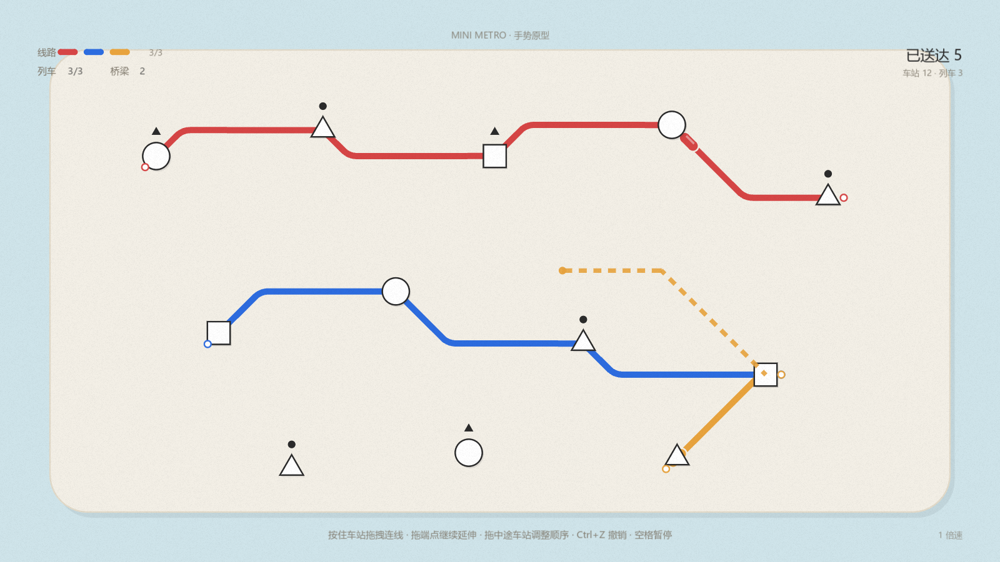

# MiniMetro（Godot 4.7）

极简地铁调度游戏 —— *Mini Metro* 机制的致敬实现，**非官方、非 1:1 复刻**。
当前进度：**M0 工程基线 + M1 画线手势 + 八向折线 + M2 核心闭环（列车 / 乘客 / 换乘 / 送达 / 溢出失败）**。
完整方案见 [设计方案](docs/设计方案.md)。


## 现在能玩到什么

- **画线**：按住车站拖拽连线，经过其他站即时接线；拖回上一站回退；拖端点手柄继续延伸；拖中途车站调整站序
- **八向线路**：任意两站之间自动拆成「45° 斜段 + 水平/竖直段」，线路只会出现水平线、竖直线、45° 斜线（与原作一致）
- **列车**：每条线自动投放 1 辆（共 3 辆），沿线往返、端点掉头、到站停靠 0.45s
- **乘客**：按目的地形状生成，围绕站点排队；上车、换乘、到站送达并计分
- **换乘寻路**：「站点 + (站点, 线路)」二部图上跑反向 Dijkstra，换乘代价高于乘车
- **压力**：等待人数超过站点容量（6）开始红色倒计时，30s 内不缓解 → 拥堵失控，`R` 重开
- `Ctrl+Z` 撤销整次手势 · `空格` 暂停 · `1/2/3` 倍速 · `R` 重开
- 线路被编辑时列车按最近站重新落位，不会卡在线外

### 超载计时与结束画面


### 画线手势（截图姿态）



## 运行

本机引擎：`D:\Downloads\06_游戏与Flash资源\Godot_v4.7.2-stable_win64.exe\Godot_v4.7.2-stable_win64.exe`（4.7.2 stable）。

```powershell
# 用编辑器打开工程
& "D:\Downloads\06_游戏与Flash资源\Godot_v4.7.2-stable_win64.exe\Godot_v4.7.2-stable_win64.exe" --path .

# 或者先导入再直接跑
& "...\Godot_v4.7.2-stable_win64_console.exe" --headless --import --path .
& "...\Godot_v4.7.2-stable_win64.exe" --path .
```

编辑器里按 F5 即可。窗口默认 1600×900，内部按 1920×1080 设计分辨率缩放。

## 测试（headless，无需显示）

```powershell
$godot = "D:\Downloads\06_游戏与Flash资源\Godot_v4.7.2-stable_win64.exe\Godot_v4.7.2-stable_win64_console.exe"
& $godot --headless --path . --script res://tests/run_tests.gd
# 期望输出：TESTS PASSED (114 checks)
```

覆盖：八向几何、弧长采样、端点手柄、网络增删、画线/撤销/重排手势、换乘寻路、自动配车、送达计分、换乘、溢出失败。
在受限沙箱里如果子进程 stdout 被管道捕获失败，用文件重定向启动：

```powershell
Start-Process -FilePath $godot -ArgumentList '--headless','--path',$PWD.Path,
  '--script','res://tests/run_tests.gd' -RedirectStandardOutput out.txt -Wait -NoNewWindow
```

## 截图 / 演示姿态

```powershell
$godot = "D:\Downloads\06_游戏与Flash资源\Godot_v4.7.2-stable_win64.exe\Godot_v4.7.2-stable_win64_console.exe"
Start-Process -FilePath $godot -ArgumentList '--path',$PWD.Path,'--',
  '--demo','--shot=C:/Users/18749/Documents/mini-metro/.shots/m1.png' -Wait -NoNewWindow
```

- `--demo`：确定性布局 11 站 + 3 条线路 + 预置乘客，并先跑 8 秒模拟（能看到列车与等待图标）
- `--pose=draft`：摆出"正在画线"的中间姿态（八向飞线虚线）
- `--pose=overload`：摆出"站点超载计时环"
- `--pose=gameover`：缩短宽限期触发结束界面
- `--seed=12345`：固定随机种子
- `--smoke=900`：无渲染跑 900 tick 后打印状态退出（冒烟测试）

## 操作

| 操作 | 作用 |
|---|---|
| 按住车站拖拽 | 新建线路 / 继续接线 |
| 拖回上一站 | 回退一段（不足两站松手自动回滚） |
| 拖端点小圆手柄 | 从该端延伸线路 |
| 拖线路中途车站 | 调整站序 |
| `Ctrl+Z` | 撤销整次手势 |
| 右键 / `Esc` | 取消当前手势 |
| `空格` | 暂停 |
| `1` / `2` / `3` | 倍速 |
| `R` | 重新开始 |

## 工程结构

```
main.tscn / main.gd       入口：装配世界与 UI、驱动模拟、截图/冒烟 CLI
autoload/game.gd          单例：一局的网络/种子/倍速
model/                    纯数据（RefCounted，不依赖 Node）
  shape.gd                站点形状（枚举 + 顶点表）
  station.gd              站点（容量/等待队列/超载计时）
  passenger.gd            乘客（只记目的地形状）
  train.gd                列车（弧长位置/方向/停靠状态/载客）
  metro_line.gd           线路（站序 + 列车 + 几何缓存）
  line_geometry.gd        八向折线 + 圆角 + 弧长表 + 端点手柄
  routing.gd              换乘寻路（二部图 + 反向 Dijkstra）
  metro_network.gd        站点/线路的唯一事实来源
  draw_util.gd            绘制小工具
sim/                      固定步长模拟
  simulation.gd           1/60s tick：生成 / 列车 / 上下车 / 溢出
  station_spawner.gd      拒绝采样生成站点
view/                     表现层（Node2D，只读模型）
  map_view.gd             水色 + 纸面陆地
  station_view.gd         站点形状 + 超载环 + 悬停
  station_layer.gd        站点视图容器
  line_layer.gd           每线一个 Line2D（Round 关节/端点）
  train_view.gd           列车胶囊（纸色描边保证可读）
  train_layer.gd          列车视图容器
  passenger_layer.gd      站内等待乘客图标
input/line_editor.gd      画线手势状态机（IDLE / DRAFT / REORDER）
ui/hud.gd                 资源槽、分数、提示、Toast、暂停/倍速、结束遮罩
tools/demo_setup.gd       截图用的确定性布局
tests/                    headless 测试（114 checks）
art/shaders/paper_grain.gdshader  极轻纸纹
docs/设计方案.md           完整实现方案（机制拆解 / 架构 / 里程碑）
```

## 几个关键实现决定

1. **八向约束放在几何层**（`LineGeometry`）：站点位置是唯一输入，`bends_between()` 决定插入哪个折点。
   规则是"从起点先走 45° 斜段，再走剩余水平/竖直段"。线路编辑、重排、undo 都只是改站序，几何自动重算。
2. **模型 / 模拟 / 视图三层分离**：`model/` 全是 `RefCounted`，`sim/` 只推进 tick，视图每帧读模型；
   单测完全绕开窗口与渲染。
3. **换乘寻路**：节点是"站点"和"站点×线路"，上车/换乘代价 1、乘车 0.01、下车 0。
   车上乘客用 `stay_cost` vs `board_cost` 决定"继续坐"还是"下车换乘"，避免在两站小线路上来回坐死循环。
4. **列车用弧长驱动**：`sample(dist)` 给位置与朝向；线路被改后按最近站重映射（`_remap_train`）。
5. **站点只存 `line_ids` 不存线路对象**：否则 `Station ↔ MetroLine` 引用环会让 `RefCounted` 永不释放（M1 时实测泄漏，已修）。
6. **中文用 `SystemFont`**（微软雅黑等），不打包字体，避免豆腐块和授权问题。

## 已知限制 / 下一步

- [ ] **M3**：每周抽卡（新线路 / 列车 / 车厢 / 桥隧）、车厢容量
- [ ] M4：河道 + 桥隧资源消耗、换乘站容量 12、特殊形状站点生成权重
- [ ] M5：音效与分层音乐、粒子/动效打磨
- [ ] M6：无尽/每日挑战模式、存档、设置、中英双语
- 乘客图标最多绘制 16 个/站（超出只保留计数与超载环），正式版可改成"挤出"动画
- 触屏依赖 Godot 的 `emulate_mouse_from_touch`（默认开启），尚未做移动端 UI 适配
- Web 导出需切 Compatibility 渲染器并压缩音频素材
- `.shots/` 是本地截图产物，已在 `.gitignore` 忽略
