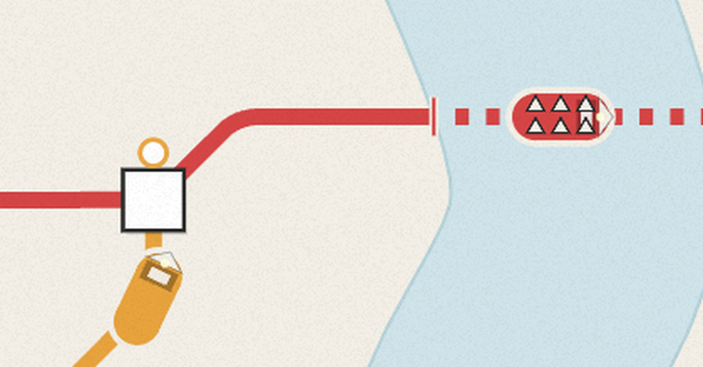
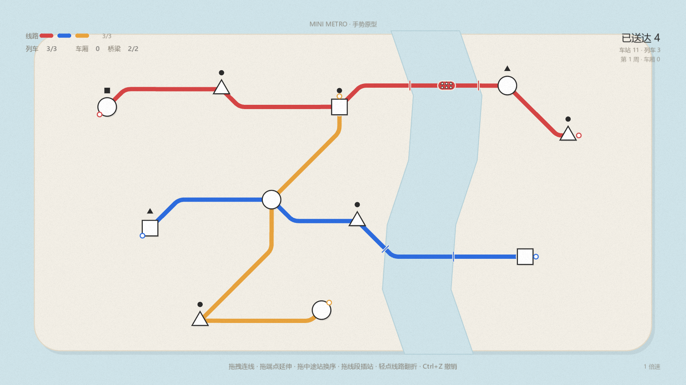
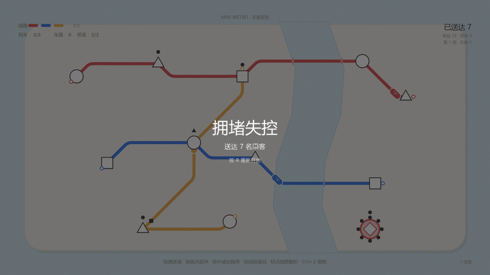

# MiniMetro（Godot 4.7）

极简地铁调度游戏 —— *Mini Metro* 机制的致敬实现，**非官方、非 1:1 复刻**。
当前进度：**M0 工程基线 → M4 河道与桥隧**（画线手势、八向折线、列车/乘客/换乘/送达/溢出、周抽卡、河道与桥隧、换乘站）。
完整方案见 [设计方案](docs/设计方案.md)。


## 现在能玩到什么

**画线 / 编辑**

- 按住车站拖拽连线，经过其他站即时接线；拖回上一站回退；拖端点手柄继续延伸；拖中途站调整站序
- **八向线路**：任意两站自动拆成「45° 斜段 + 水平/竖直段」，只出现水平线、竖直线、45° 斜线
- **轻点线路**：翻转该段折线的弯曲方向（先 45° ↔ 先水平/竖直）
- **拖拽线段插入车站**：从两站之间的线路中间拖到别的站，把它插进这两站之间
- **停留 1.5 秒移出车站**：拖拽画线时把指针停在"已在本线路上"的站点上，红色进度环满 1.5s 后把该站移出
- `Ctrl+Z` 撤销整次手势（含弯曲方向、站序、插入/移除）

**运营**

- 每条线自动投放列车（默认 3 辆），沿线往返、端点掉头、到站停靠
- **列车内显示乘客**：车身上按座位排布目的地形状小图标（1~3 人一排、4~6 人两排）
- 乘客按目的地形状生成、围绕站点排队、上车 / 换乘 / 到站送达计分
- 站点等待超容量（6，换乘站 12）→ 红色超载计时环，30s 不缓解 → 拥堵失控，`R` 重开
- **每周抽卡**：新线路 / 列车 / 车厢 / 桥梁隧道 / 换乘站，二选一
- **河道与桥隧**：线路每穿过一次河道消耗 1 座桥/隧道；额度不足时跨河接线被拒绝并提示
- 站点生成会避开河道与河岸（最小离岸距离），稀有菱形/星形站按权重出现

## 截图

### 河道、桥隧与路网


### 随机开局（河道把城市切成两半）


### 换乘站（容量 12，图标更大）


### 列车内的乘客





### 拖拽线段插入车站


### 每周升级


### 压力与失败




### 画线中间态


## 运行

本机引擎：`D:\Downloads\06_游戏与Flash资源\Godot_v4.7.2-stable_win64.exe\Godot_v4.7.2-stable_win64.exe`（4.7.2 stable）。

```powershell
# 用编辑器打开工程
& "D:\Downloads\06_游戏与Flash资源\Godot_v4.7.2-stable_win64.exe\Godot_v4.7.2-stable_win64.exe" --path .

# 或者先导入再直接跑
& "...\Godot_v4.7.2-stable_win64_console.exe" --headless --import --path .
& "...\Godot_v4.7.2-stable_win64.exe" --path .
```

编辑器里按 F5 即可。窗口默认 1600×900，内部按 1920×1080 设计分辨率缩放。

## 测试（headless，无需显示）

```powershell
$godot = "D:\Downloads\06_游戏与Flash资源\Godot_v4.7.2-stable_win64.exe\Godot_v4.7.2-stable_win64_console.exe"
& $godot --headless --path . --script res://tests/run_tests.gd
# 期望输出：TESTS PASSED (184 checks)
```

覆盖：八向几何与弯曲翻转、弧长采样、网络增删、画线/撤销/重排/翻转/插站/停留移除手势、换乘寻路、
自动配车、送达计分、换乘、溢出失败、周循环抽卡与资源/车厢生效、河道检测与桥隧预算、站点避水、形状权重。

沙箱里若子进程 stdout 被管道捕获失败，用文件重定向启动：

```powershell
Start-Process -FilePath $godot -ArgumentList '--headless','--path',$PWD.Path,
  '--script','res://tests/run_tests.gd' -RedirectStandardOutput out.txt -Wait -NoNewWindow
```

## 截图 / 演示姿态

```powershell
$godot = "D:\Downloads\06_游戏与Flash资源\Godot_v4.7.2-stable_win64.exe\Godot_v4.7.2-stable_win64_console.exe"
Start-Process -FilePath $godot -ArgumentList '--path',$PWD.Path,'--',
  '--demo','--shot=C:/Users/18749/Documents/mini-metro/.shots/m1.png' -Wait -NoNewWindow
```

- `--demo`：确定性布局 11 站 + 3 条线路（含两处跨河）+ 预置乘客，并先跑 8 秒模拟
- `--pose=riders` / `insert` / `draft` / `overload` / `gameover` / `week` / `interchange`：摆出对应姿态
- 不传 `--demo` 时是随机开局地图（河道两侧都可能有站）
- `--seed=12345` / `--smoke=900`：固定种子 / 无渲染跑 tick 后打印状态

注意：`--shot`、`--demo`、`--pose` 等是用户参数，必须放在 `--` 之后；且 PowerShell 里不要把数组参数命名为 `$args`（会与自动变量冲突导致参数丢失）。

## 操作

| 操作 | 作用 |
|---|---|
| 按住车站拖拽 | 新建线路 / 继续接线 |
| 拖回上一站 | 回退一段（不足两站松手自动回滚） |
| 拖端点小圆手柄 | 从该端延伸线路 |
| 拖线路中途车站 | 调整站序 |
| 拖拽中停在已在线路上的站 1.5s | 把该站移出线路（红色进度环） |
| 轻点线路 | 翻转该段折线弯曲方向 |
| 从线段中间拖到别的站 | 把该站插入这两站之间 |
| `Ctrl+Z` | 撤销整次手势 |
| 右键 / `Esc` | 取消当前手势 |
| `空格` | 暂停 |
| `1` / `2` / `3` | 倍速（周结算弹窗打开时改为选择升级卡） |
| `R` | 重新开始 |

## 工程结构

```
main.tscn / main.gd       入口：装配世界与 UI、驱动模拟、截图/冒烟 CLI
autoload/game.gd          单例：一局的网络/种子/倍速（默认地图注入河道）
model/                    纯数据（RefCounted，不依赖 Node）
  shape.gd                站点形状（枚举 + 顶点表）
  station.gd              站点（容量/等待队列/超载计时）
  passenger.gd            乘客（只记目的地形状）
  train.gd                列车（弧长位置/方向/停靠状态/载客）
  metro_line.gd           线路（站序 + 弯曲翻转 + 车厢 + 列车 + 几何缓存）
  line_geometry.gd        八向折线（可翻转）+ 圆角 + 弧长表 + 端点手柄
  routing.gd              换乘寻路（二部图 + 反向 Dijkstra）
  metro_network.gd        站点/线路的唯一事实来源 + 河道/桥隧预算
  draw_util.gd            绘制小工具
sim/                      固定步长模拟
  simulation.gd           1/60s tick：生成 / 列车 / 上下车 / 溢出 / 周循环
  station_spawner.gd      拒绝采样生成站点（避水、最小间距、形状权重）
view/                     表现层（Node2D，只读模型）
  map_view.gd             水色背景 + 纸面陆地 + 河道
  station_view.gd         站点形状 + 超载环 + 换乘站放大
  station_layer.gd        站点视图容器
  line_layer.gd           每线一个 Line2D（Round 关节/端点）
  bridge_layer.gd         跨河处的桥面记号
  train_view.gd           列车胶囊 + 车内乘客图标 + 纸色描边
  train_layer.gd          列车视图容器
  passenger_layer.gd      站内等待乘客图标
input/line_editor.gd      画线手势状态机（IDLE / DRAFT / REORDER / SEGMENT）
ui/hud.gd                 资源槽、分数、提示、Toast、周抽卡弹窗、结束遮罩
data/level_data.gd        地图/河道/资源/节奏/周时长/形状权重配置
data/upgrade_cards.gd     周奖励卡池（线路/列车/车厢/桥梁/换乘站）
tools/demo_setup.gd       截图用确定性布局
tests/                    headless 测试（184 checks）
art/shaders/paper_grain.gdshader  极轻纸纹
docs/设计方案.md           完整实现方案（机制拆解 / 架构 / 里程碑）
```

## 几个关键实现决定

1. **八向约束在几何层**：站点位置是唯一输入，`bends_between()` 决定折点位置；翻转状态按「有序站点 id 对」存在
   `MetroLine.bend_flips`，插站、换序、undo 都不会串位。
2. **桥隧预算从几何反推**：不维护"已用桥"的计数，而是每次由 `used_bridges()` 扫线路的八向折线与河道多边形求交，
   所以撤销/重排/删除线路后额度自动正确；编辑器在接线、插站、重排前做预算校验，不够就拒绝并提示。
3. **手势只改数据**：`LineEditor.begin/move/end/advance` 是纯 API（测试直接调用），停留计时、线段命中、
   插入位置都在这里判定；视图每帧轮询模型。
4. **线段命中用弧长**：`nearest_distance()` 把指针投影到弧长，再用 `stop_offsets` 判断落在哪两站之间；
   轻点翻转、拖拽插站共用这套判定。
5. **列车用弧长驱动**，线路被编辑后按最近站重映射（`_remap_train`）；同线多车按已有列车数错开起始站与方向。
6. **周循环暂停在模拟层**：`week_pending` 让 `advance()` 返回，UI 选择后继续；卡池按资源上限过滤。
7. **站点只存 `line_ids` 不存线路对象**：避免 `Station ↔ MetroLine` 引用环导致 `RefCounted` 泄漏。
8. **中文用 `SystemFont`**（微软雅黑等），不打包字体，避免豆腐块和授权问题。

## 已知限制 / 下一步

- [ ] **M5**：音效与分层音乐、粒子/动效打磨（道岔/进站/送达反馈）
- [ ] M6：无尽/每日挑战模式、存档、设置、中英双语
- 换乘站升级自动选"最拥挤的容量 6 站点"，没有做手动选点交互
- 桥隧只有额度与记号，没有"桥/隧道"两种形态差异（暂时统一按桥处理）
- 列车内最多绘制 6 个乘客图标（车厢扩容后不会画全部乘客）
- 触屏依赖 Godot 的 `emulate_mouse_from_touch`（默认开启），尚未做移动端 UI 适配
- Web 导出需切 Compatibility 渲染器并压缩音频素材
- `.shots/` 是本地截图产物，已在 `.gitignore` 忽略
